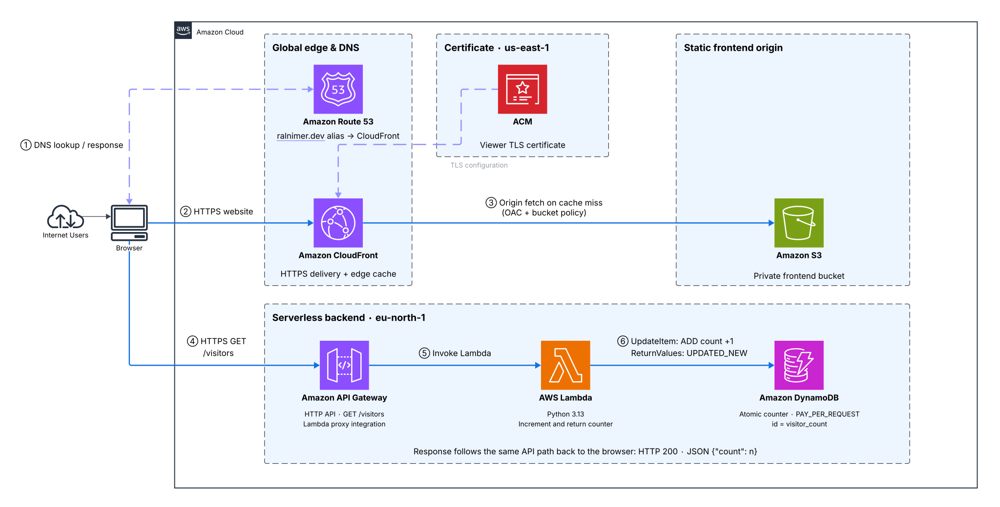

# DevPortfolio v2.0

A React portfolio built with Vite and hosted on AWS as an implementation of the Cloud Resume Challenge.

Version 2.0 replaces the original static website with reusable React components and a NieR:Automata-inspired design: warm beige and charcoal styling, a spinning ASCII chip, responsive navigation, and optional interface sounds.

The project focuses on designing and deploying a serverless AWS architecture, managing infrastructure with Terraform, and automating testing and deployment through GitHub Actions.

## Architecture

[](docs/architecture/ralnimer-dev-architecture.svg)

Click the diagram to view it at full size. Update it by replacing `docs/architecture/ralnimer-dev-architecture.svg`.

- **Website delivery:** Route 53 resolves the custom domain to CloudFront. CloudFront serves the static frontend from a private S3 origin using Origin Access Control (OAC), with an ACM certificate for HTTPS.
- **Visitor counter:** The browser calls API Gateway directly at `GET /visitors`. A Python Lambda function atomically increments a DynamoDB counter and returns the updated count. This counts requests, not unique visitors.
- **Access control:** The Lambda execution role permits `dynamodb:UpdateItem` on the counter table, and a resource-based policy permits API Gateway to invoke Lambda. API CORS allows `https://ralnimer.dev`.

The backend is configured in `eu-north-1`. Frontend DNS, CloudFront, S3 hosting, and ACM are configured outside the backend Terraform files.

## Local Development

The React version is developed in `frontend/` using Vite:

```sh
cd frontend
npm ci
npm run dev
```

To create a production build, run `npm run build` from that directory. Output is written to `frontend/dist/`.

React is now the only frontend. GitHub Actions builds it and deploys `frontend/dist/` to S3. The original website remains available in Git history.

## Infrastructure as Code

The backend infrastructure is managed using **Terraform** rather than being configured manually.

Terraform provisions and manages resources including:

- DynamoDB
- Lambda
- IAM roles and policies
- API Gateway

Terraform state is stored in an existing S3 bucket with encryption and native S3 lockfiles enabled. The state bucket is separate from the frontend bucket; DynamoDB is used for the visitor counter, not state locking.

## CI/CD

GitHub Actions runs backend tests, a React production build, and Terraform checks on pull requests and pushes to `main`. Deployment runs only on pushes to `main`, after all three checks succeed.

```text
Pull request / push to main
     |
     +-- Backend Tests ---------+
     |                          |
     +-- React Build -----------+
     |                          |
     +-- Terraform Checks ------+
                                |
                      All checks pass
                      + push to main
                                |
                     +----------+----------+
                     |                     |
              Deploy Backend        Deploy Frontend
```

The pipeline:

1. Runs Python unit tests for the Lambda backend.
2. Installs frontend dependencies with `npm ci` and builds the React app.
3. Checks Terraform formatting and configuration, then saves an execution plan.
4. Applies the saved infrastructure plan after all checks pass.
5. Downloads the verified frontend build artifact and synchronizes it with S3.
6. Requests a CloudFront cache invalidation after the frontend sync.

Backend and frontend deployments run independently after the checks pass. Frontend sync excludes `resources/*`, preserving documents uploaded separately to S3. Local resources live in `frontend/public/resources/`. They are ignored by Git and must be provided separately for local previews or uploaded to S3 for updated downloads.

GitHub Actions authenticates to AWS using **OpenID Connect (OIDC)** and IAM roles instead of storing long-lived AWS access keys in GitHub.

## Repository Structure

```text
.
├── .github/
│   └── workflows/
│       └── ci.yml
├── backend/
│   ├── lambda_function.py
│   └── tests/
├── docs/
│   └── architecture/
│       └── ralnimer-dev-architecture.svg
├── frontend/
│   ├── src/
│   │   ├── components/
│   │   ├── data/
│   │   ├── hooks/
│   │   └── lib/
│   ├── public/
│   ├── index.html
│   ├── package.json
│   └── vite.config.js
└── terraform/
    ├── main.tf
    ├── providers.tf
    ├── variables.tf
    └── outputs.tf
```

## Technologies

**AWS:** S3, CloudFront, Route 53, ACM, API Gateway, Lambda, DynamoDB, IAM

**Infrastructure:** Terraform

**CI/CD:** GitHub Actions, GitHub OIDC

**Backend:** Python, boto3, pytest

**Frontend:** React, Vite, CSS, JavaScript
